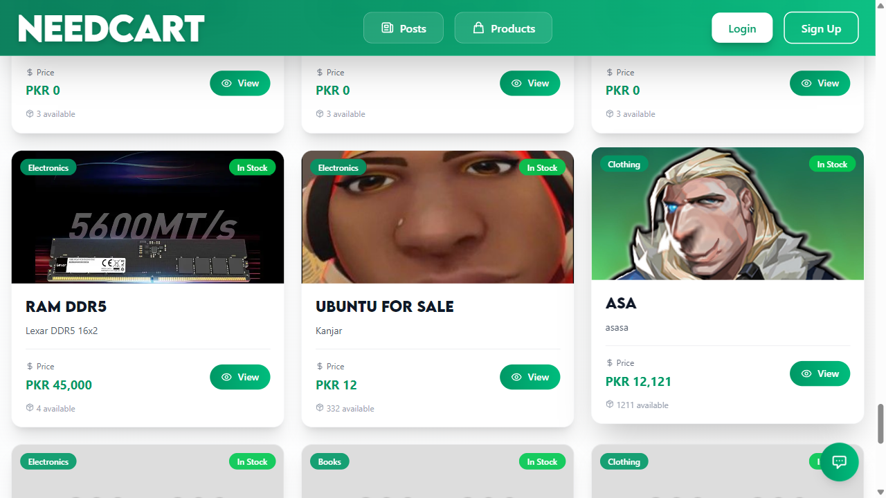
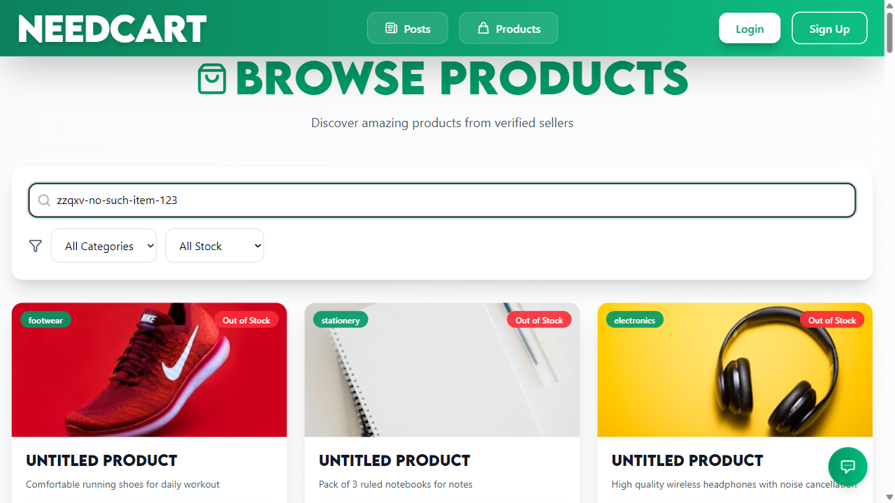
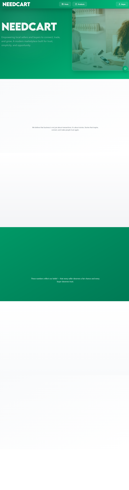
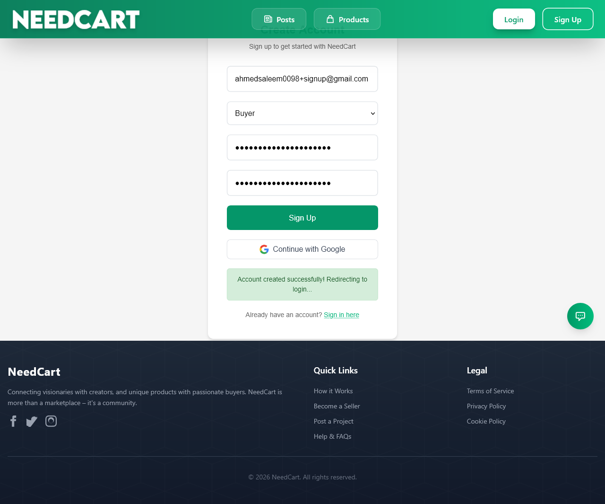
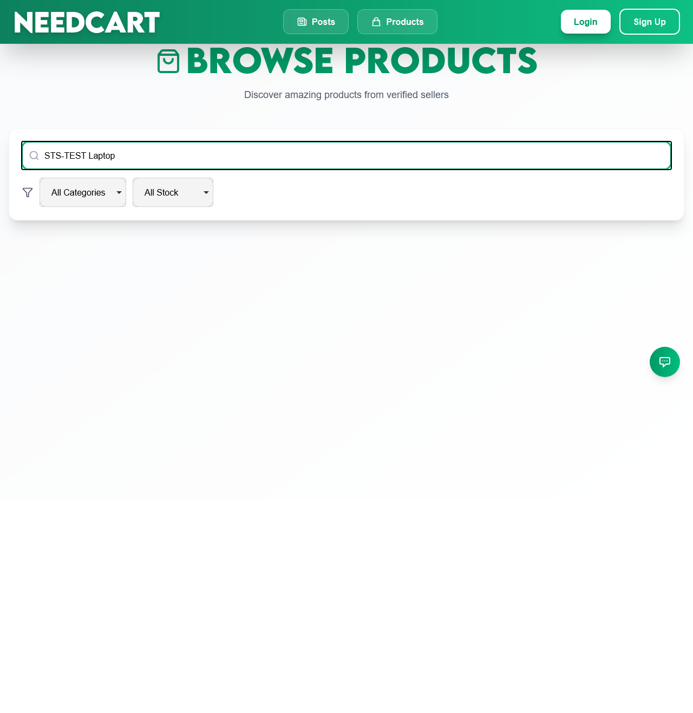
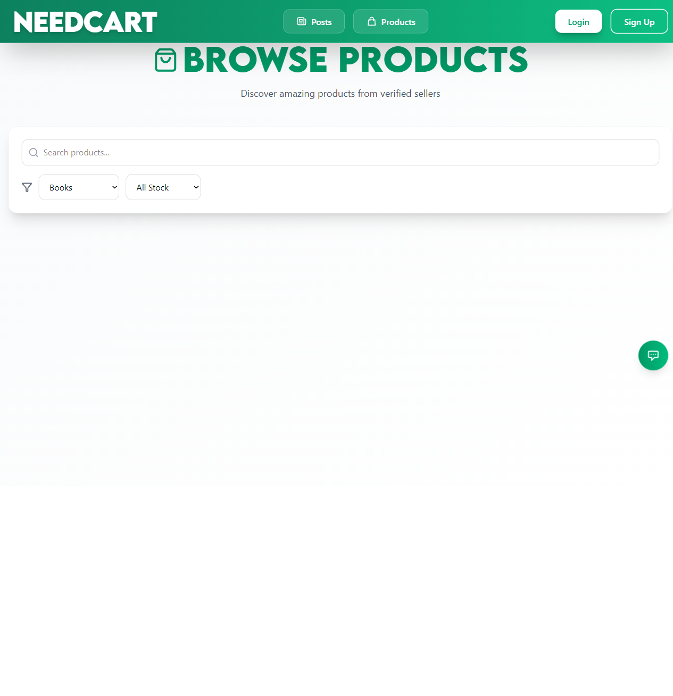
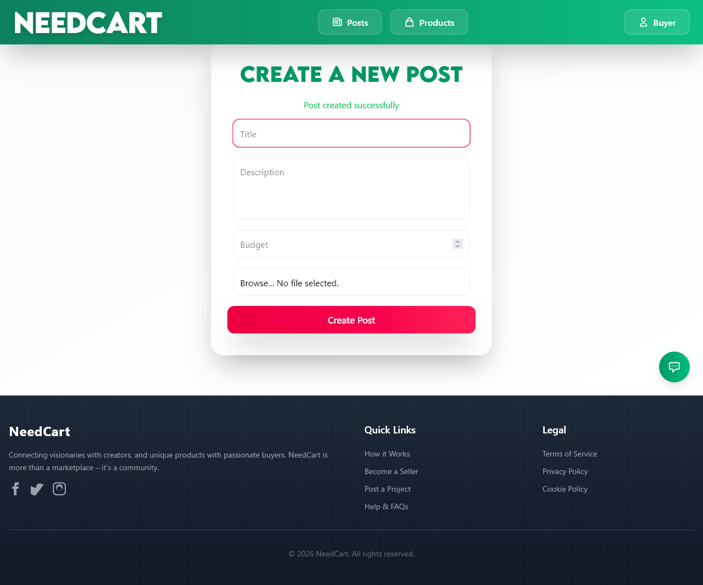
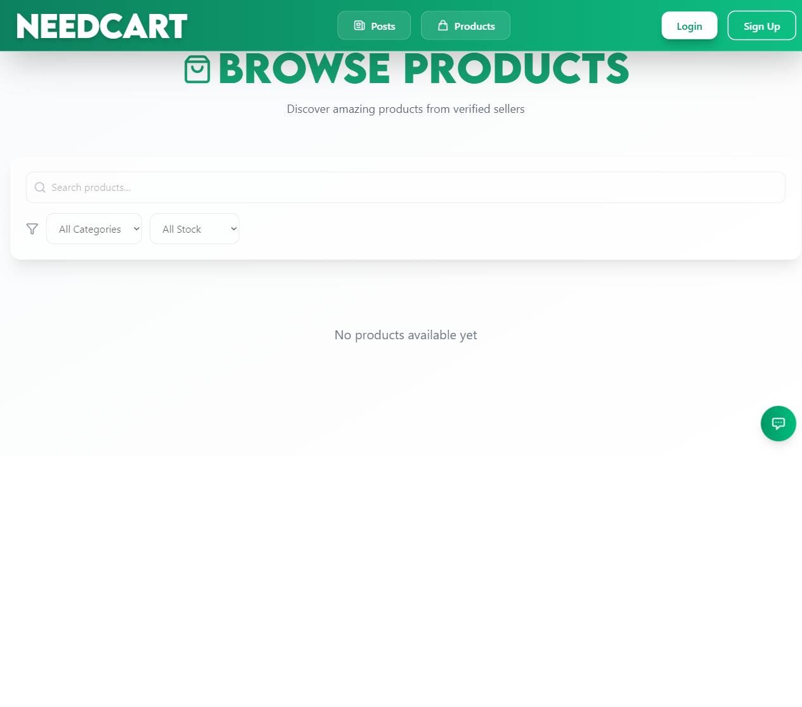
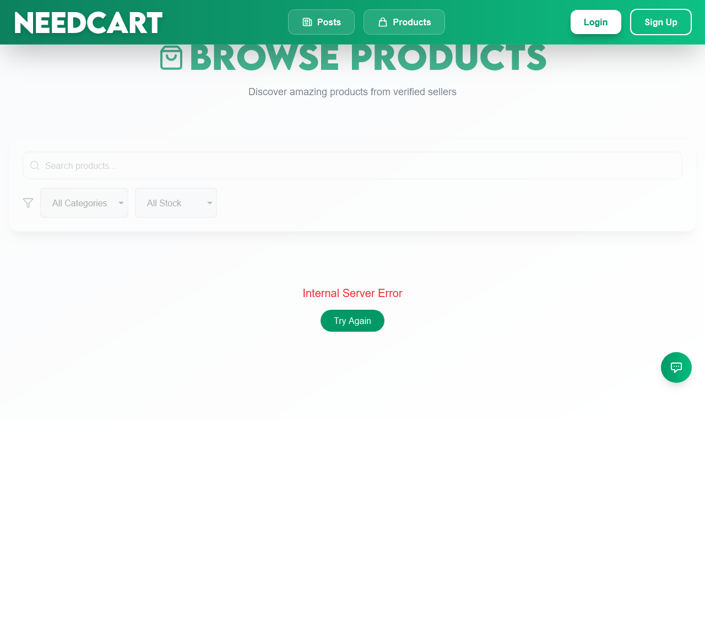

# Software Testing: Playwright Automation of NeedCart

**Team:** Shaheer, Ahmed  **Course:** ________  **Instructor:** ________  **Date:** 30 October 2026

This is the single report for the whole assignment. The only generated HTML file is the raw pytest-html evidence of the final run: [reports/report.html](reports/report.html).

---

## 1. Introduction
NeedCart is a marketplace where buyers post requirements and sellers list products (React + Vite frontend, Express + MongoDB backend, Firebase authentication). The goal of this work was to build an automated Playwright (Python, pytest) suite that checks four user-facing features end to end, the products API, and how the page behaves when the network misbehaves, and to prove the suite catches a deliberately introduced bug.

## 2. Tools and environment
| Item | Value |
|---|---|
| OS | Windows 11 Pro Education 10.0.26200 |
| Python | 3.12.10 |
| Playwright (Python) | 1.64.1 |
| pytest / pytest-playwright / pytest-html / pytest-rerunfailures | 9.2.0 / 0.10.0 / 4.2.0 / 16.7 |
| Other libraries | pymongo 4.19.0, requests 2.34.2, python-dotenv 1.2.4 |
| Browsers | Chromium 156.0.8078.4, Firefox 157.0, WebKit 27.2 |
| App under test | Frontend `http://localhost:5173`, backend `http://localhost:8000`, MongoDB Atlas db `NeedKart`, Firebase Auth |
| Run mode | **Headed** (real browser windows, `--headed --slowmo 150`), so every action can be watched live |

## 3. Testing approach
- **E2E (12 tests):** real browser, user-facing locators (role, placeholder, text), asserts on what the user sees (URL, headings, messages, lists). Page Objects live in `pages/`.
- **API (4 CRUD tests + 2 extra):** Playwright `APIRequestContext` with a Firebase ID token (`Authorization: Bearer`), asserting status code and body. No browser, so they run once.
- **Network mocking (2 tests):** `page.route()` on `**/product/all` fakes an empty list and a 500 error; both also fail on any uncaught JavaScript error.
- **Cross-browser:** the same suite on Chromium, Firefox and WebKit in one run, plus Pixel 7 mobile emulation (E2E + mock).
- **Intentional bug:** one-line break of the search filter on a throw-away git branch, to show the suite fails when the app is wrong.
- **Test data:** dedicated accounts and records titled `STS-TEST…`, removed after every test and at session start/end. The database has 0 leftover `STS-TEST` records after the final runs. No `time.sleep` in any test; waiting is done with Playwright auto-waiting `expect()`.
- **Retries:** a failed test is retried up to 2 times because calls to Firebase / Atlas / Cloudinary over this internet connection occasionally drop. The two final full runs needed **0 reruns**.

## 4. Features tested / left out
**Tested:** Login, Signup + OTP, Product browse/search/filter, Buyer create post, Products API CRUD, Network failure handling.

**Left out, with reasons**
| Feature | Reason |
|---|---|
| Stripe payments | Third-party iframe, test-card flows, risky to automate |
| Google OAuth login | Third-party popup; Google blocks automated sign-in |
| Gemini AI chatbot | Answers change every time, nothing stable to assert |
| Cloudinary image quality | External service, slow, uses quota (it is only exercised because creation requires an image) |
| Admin dashboard | Needs an admin account; lower user-facing priority |
| Real email delivery | External SMTP (and it is broken here, see 9.2); OTP is read from MongoDB |
| Offers, orders, escrow, reviews | Multi-user, multi-step flows that depend on payments |

## 5. What differs from the plan (adaptations)
| Plan | Reality in the code | What we did |
|---|---|---|
| `/api/...` routes, PUT/DELETE | Routes have no `/api` or version prefix; delete is `POST /product/remove/:id` | Used the real routes |
| Product update (PUT) | **No product update endpoint exists** | TC-15 uses the only real update: `PATCH /buyer-dashboard/posts/:id/status` |
| Login redirects to buyer dashboard | Redirects to `/` | Asserted `/` plus the "Buyer" menu |
| Signup logs the user in | After the OTP the app shows a message and goes to `/login` | Asserted message + URL + buyer record in MongoDB |
| Login error shown on page | Shown in a browser `alert()` | Test captures the dialog |
| Image optional? | **Mandatory** (Multer → Cloudinary) | Tiny `fixtures/test-image.png` (74 bytes) |
| Seed products via the API | Would need 3 Cloudinary uploads per run | Seeded straight into MongoDB; API create is covered by TC-13 |
| Seller can add products | Sellers must be approved by an admin | Setup script sets `is_verified` in MongoDB |
| Signup email works | Gmail rejects the backend's app password (signup returns 500 after saving the OTP) | The signup page object and setup script treat exactly that "Failed to send OTP email" answer as success; any other error is passed through unchanged |
| Delete test Firebase user via REST | Needs the user's token and Firebase rate-limits sign-ins | `scripts/delete_firebase_user.mjs` uses the backend's own Admin SDK setup |
| Separate HTML report per browser | Requested change: one report | One `reports/report.html` + this file |

`data-testid` attributes added to the app (only 2): `product-card` (`Frontend/src/components/Product/ProductCard.jsx`) and `category-filter` (`Frontend/src/pages/Products.jsx`).

## 6. Test cases
Result = final headed run on Chromium, Firefox and WebKit (all three agree).

| ID | Feature | Type | Description | Expected result | Actual result | Status | Owner |
|---|---|---|---|---|---|---|---|
| TC-01 | Login | Positive | Valid buyer email + password | Lands on `/`, "Buyer" menu visible, Login link gone | As expected | Pass | Shaheer |
| TC-02 | Login | Negative | Valid email, wrong password | Error alert (`auth/invalid-credential`), stays on `/login` | As expected | Pass | Shaheer |
| TC-03 | Login | Negative | Empty email and password | Submit blocked by `required`, no navigation, no alert | As expected | Pass | Shaheer |
| TC-04 | Signup | Positive | Sign up as buyer, OTP read from MongoDB | OTP modal, then "Account created successfully!", `/login`, buyer record exists; account cleaned up | As expected | Pass | Shaheer |
| TC-05 | Signup | Negative | Email `notanemail` | Browser validation error, no OTP modal, no OTP stored | As expected | Pass | Shaheer |
| TC-06 | Signup | Negative | Wrong OTP `000000` | "Invalid or expired OTP", modal stays, no account | As expected | Pass | Shaheer |
| TC-07 | Product search | Positive | Search `STS-TEST Laptop` | Laptop card visible; Novel and Tshirt absent | As expected | Pass | Ahmed |
| TC-08 | Product filter | Positive | Category = Books | Novel visible, laptop absent, every card shows "Books" | As expected | Pass | Ahmed |
| TC-09 | Product search | Negative | Search `zzqxv-no-such-item-123` | "No products found matching your criteria", 0 cards, page intact | As expected | Pass | Ahmed |
| TC-10 | Create post | Positive | Logged-in buyer submits valid form | "Post created successfully", post found in `/posts`, one DB record, cleaned up | As expected | Pass | Ahmed |
| TC-11 | Create post | Negative | Empty title | Blocked by form validation, nothing saved | As expected | Pass | Ahmed |
| TC-12 | Create post | Negative | Budget `-100` | Request rejected (4xx), no post saved | **Server accepted it and created the post** | **XFail (BUG-02)** | Ahmed |
| TC-13 | API Create | API | `POST /product/add` as seller; same call without token | 201 with `_id`, title, price; no token → 401/403 | As expected | Pass | Shaheer |
| TC-14 | API Read | API | `GET /product/getOne/:id`; valid-format unknown id | 200 with the data; unknown id → 404 "Product not found" | As expected | Pass | Shaheer |
| TC-15 | API Update | API | `PATCH /buyer-dashboard/posts/:id/status` → closed, then GET; invalid status | 200, GET shows `closed`; invalid → 400 | As expected | Pass | Shaheer |
| TC-16 | API Delete | API | `POST /product/remove/:id`, then GET | 200, then 404 | As expected | Pass | Shaheer |
| TC-17 | Mock | Mock | `/product/all` returns 200 with empty list | "No products available yet", no cards, no JS errors | As expected | Pass | Ahmed |
| TC-18 | Mock | Mock | `/product/all` returns 500 `Internal Server Error` | Error text + "Try Again" button, header still shown, no cards, no JS errors | As expected | Pass | Ahmed |
| TC-14b | API (extra) | API | `GET /product/getOne/not-an-id` | 400 or 404 | **500 (Mongoose CastError)** | **XFail (BUG-01)** | Shaheer |
| TC-16b | API (extra) | API | `POST /product/remove/<unknown id>` | 404 | **500 (TypeError on null product)** | **XFail (BUG-03)** | Shaheer |

An XFail means the test asserts the correct behaviour and fails because the application is wrong (`xfail(strict=True)`, so it turns into a hard failure the day the bug is fixed).

## 7. Results
### 7.1 Cross-browser
Run 1 and run 2 of the full suite (headed, one pytest command, `--browser chromium --browser firefox --browser webkit`) both gave **43 passed, 5 xfailed, 0 failed, 0 reruns** (4 min 54 s and 5 min 39 s), so no flaky tests were observed in the final code.

| Browser | Tests run | Passed | Failed | XFailed | Notes |
|---|---|---|---|---|---|
| Chromium 156 | 14 (12 E2E + 2 mock) | 13 | 0 | 1 (TC-12) | |
| Firefox 157 | 14 | 13 | 0 | 1 (TC-12) | |
| WebKit 27.2 | 14 | 13 | 0 | 1 (TC-12) | |
| API (browser-independent, run once) | 6 | 4 | 0 | 2 (TC-14b, TC-16b) | |
| **All browsers, total** | **48** | **43** | **0** | **5** | [reports/report.html](reports/report.html) |
| Chromium, Pixel 7 emulation (E2E + mock) | 14 | 13 | 0 | 1 (TC-12) | console run, screenshots in `screenshots/chromium-mobile/` |

### 7.2 How the suite got to green (honest log)
Earlier runs failed for reasons that were fixed in the tests, not hidden: a missing `base_url` argument in a fixture, a race on the login `alert` (TC-02), two elements matching the same OTP error text (TC-06), Firebase sign-in rate-limiting caused by the cleanup of the signup account (replaced by the Admin-SDK script), a login that occasionally dropped on a flaky connection (the login fixture now retries up to 3 times), and our own retry-click helper wrongly retrying when TC-11's form is correctly blocked. No test was weakened to pass: TC-12, TC-14b and TC-16b still assert the correct behaviour.

## 8. Intentional bug demo (owner: Shaheer)
- **Change:** in `Frontend/src/pages/Products.jsx` (line 63) the search predicate was replaced by `const matchesSearch = true;`, so the search box ignores what is typed. Done on a temporary git branch `bug-demo`; diff in [bug-demo/bug.patch](bug-demo/bug.patch).
- **Run:** `tests/e2e/test_product_search.py` on Chromium, headed. Result: **2 failed, 1 passed**.
  - TC-07 failed: `Locator expected to have count '0' ... unexpected value "1"` (the STS-TEST Novel card was still shown while searching for the laptop). Screenshot: 
  - TC-09 failed: `Locator expected to be visible` (no "no products found" message, because every product matches). Screenshot: 
  - TC-08 (category filter) correctly still passed.
- **Revert:** change checked out, branch deleted without merging, back on `main`; the search tests then passed again (3 passed). Details: [bug-demo/README.md](bug-demo/README.md).

## 9. Bugs found (real, in the application)
| Bug ID | Description | Found by | Expected | Actual | Severity |
|---|---|---|---|---|---|
| BUG-01 | `GET /product/getOne/:id` with a malformed id | TC-14b | 400 or 404 | 500 with a raw Mongoose "Cast to ObjectId failed" message | Low–Medium |
| BUG-02 | Create post with a negative budget (-100) | TC-12 | Rejected with an error | Accepted; the post is saved (backend only checks `!budget`, the form has no `min`) | Medium |
| BUG-03 | `POST /product/remove/:id` with an id that does not exist | TC-16b | 404 | 500 (code reads `product.sellerId` on `null`) | Low–Medium |
| BUG-04 | On screens narrower than 768 px the navbar's Posts and Products links are hidden (`hidden md:flex`) and there is no menu button | Mobile run (TC-18 first assertion) | Navigation reachable on phones | Links missing | Medium (usability) |

### 9.2 Environment / other observations
- **Signup email is broken on this machine:** Gmail answers `535 Username and Password not accepted` for the backend's app password, so `POST /auth/signup` always returns 500 after saving the OTP and the real signup UI never shows the OTP screen. Fix by creating a new Gmail app password in `Backend/.env`. The tests work around only this one error (see section 5).
- **Security:** an uncommitted/committed `console.log(idToken)` in `Backend/src/middlewares/verifyIdToken.middleware.js` prints every user's Firebase ID token to the server log. It is not part of the tests and should be removed.
- **Google login** in `auth.config.js` posts to `VITE_VERCEL_URL`, a variable not used anywhere else (not tested, noted only).

## 10. Screenshots (final run)
| | |
|---|---|
|  TC-01 login (Chromium) |  TC-04 signup (Firefox) |
|  TC-07 search (WebKit) |  TC-08 filter (Chromium) |
|  TC-10 create post (Firefox) |  TC-17 empty list mock |
|  TC-18 server-error mock (WebKit) |  TC-01 on Pixel 7 emulation |

All positive-test screenshots exist for every browser in `screenshots/chromium|firefox|webkit|chromium-mobile/`.

## 11. Work division
| Member | Responsibility |
|---|---|
| **Shaheer** (A) | Feature 1 Login (TC-01–03), Feature 2 Signup + OTP (TC-04–06), API CRUD tests (TC-13–16), test-user setup script, intentional bug demo |
| **Ahmed** (B) | Feature 3 Product search/filter (TC-07–09), Feature 4 Create post (TC-10–12), network mocking (TC-17–18), cross-browser runs |
| Both | Shared fixtures and utilities (`conftest.py`, `utils/`, `pages/`), README, this report |

## 12. How to run
```
cd "STS CEA"
.venv\Scripts\activate
python scripts/setup_test_users.py                          # once
pytest                                                      # all browsers: add --browser chromium --browser firefox --browser webkit
pytest --browser chromium --device "Pixel 7" -m "e2e or mock"
pytest tests/e2e/test_login.py                              # one file;  pytest -m negative  # one marker
```
Backend (`npm start` in `Backend/`) and frontend (`npm run dev` in `Frontend/`) must be running. Runs are headed by default (see `pytest.ini`). Delete `.env.test`, `.venv/` and `test-results/` before zipping.

## 13. Conclusion
The suite covers four features, the products API and network-failure handling with 18 required tests plus 2 extra ones. After fixing test-side problems it passes 43/43 non-xfail tests on Chromium, Firefox and WebKit, twice in a row with no reruns, and 13/13 on mobile emulation. It found four real application problems (BUG-01 to BUG-04) and one environment fault (broken Gmail credentials), and the one-line search bug was caught by two tests as intended. Remaining limits: payments, Google login, the chatbot and admin features are not automated, and Cloudinary/Firebase/Atlas are real external services, so the suite needs an internet connection.
